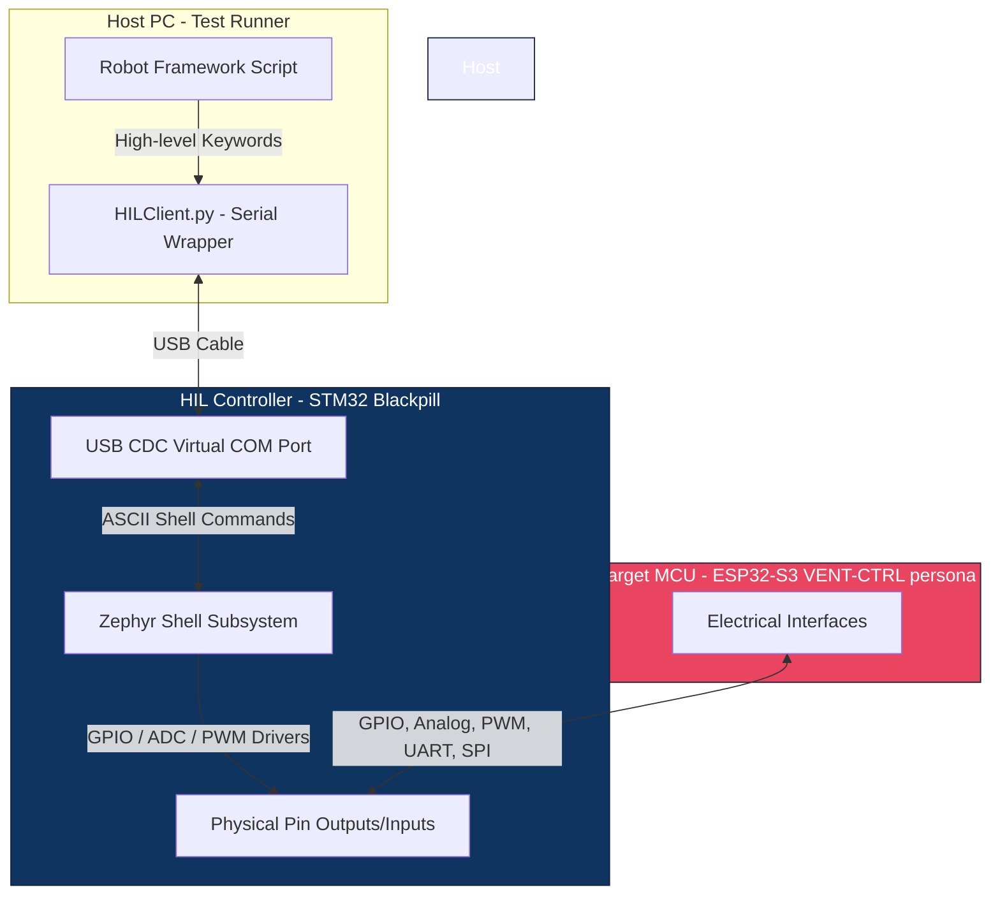

# Pix-in-the-Loop

[](https://zephyrproject.org/)
[](https://robotframework.org/)
[](https://www.st.com/en/microcontrollers-microprocessors/stm32f401.html)
[](LICENSE)

**Pix-in-the-Loop ** is a high-performance, modular Hardware-in-the-Loop (HIL) testing platform. It bridges the gap between high-level test automation on a PC and real-time physical stimulation on embedded targets.

By pairing the highly readable, keyword-driven **Robot Framework** on the host PC with a deterministic **Zephyr RTOS** controller running on an **STM32F401 Blackpill**, PIL delivers a flexible, robust, and cost-effective test environment. This architecture allows developers and QA teams to run complex hardware integration and validation suites with automated, color-coded HTML report generation.

---

## System Architecture

PIL decouples high-level test logic from real-time electrical stimulus. The platform is divided into three distinct layers:



1. **The Test Runner (PC):** Runs Robot Framework. It parses readable `.robot` files, sends serialized ASCII commands to the Zephyr HIL Controller, monitors return signals, asserts expected behaviors, and compiles a comprehensive HTML log/report.
2. **The HIL Controller (Zephyr RTOS + Blackpill):** Acts as a smart hardware-to-software I/O bridge. It runs Zephyr's interactive **Shell Subsystem** over **USB CDC (Serial)**. It takes parameterized ASCII commands (e.g., `ctrl gpio_set A 5 1`), executes them directly using bare-metal HAL/drivers, and responds back immediately.
3. **The Target MCU (Device Under Test - DUT):** The system undergoing testing. The DUT simply reacts to physical electrical signals (analog, digital, PWM, serial) provided or measured by the HIL Controller. In this project it is an **ESP32-S3** running the *VENT-CTRL* ventilation-controller persona — see [`DUT/`](DUT/README.md).

---

## Hardware & Pin Allocation Matrix

To maximize the capabilities of the **STM32F401 Blackpill** while protecting critical debugging and communication lines, specific pins have been reserved. The remaining pins are multiplexed to serve as a high-density, multi-protocol I/O hub.

| Peripheral | Pin Assignment | Signal Type | Description |
| :--- | :--- | :--- | :--- |
| **System (Reserved)** | PA11, PA12, PA13, PA14 | Debug & USB | SWD Debugging (SWDIO/SWCLK) and USB CDC Serial connection. |
| **USART1** | PA9 (TX), PA10 (RX) | Digital Serial | High-speed primary UART channel to the DUT. |
| **USART2** | PA2 (TX), PA3 (RX)* | Digital Serial | Secondary UART channel to the DUT (*Shared with ADC1_IN2 / ADC1_IN3). |
| **SPI1** | PB3 (SCK), PB4 (MISO), PB5 (MOSI) | SPI Bus | Primary SPI bus (relocated to Port B so it no longer shadows ADC channels). |
| **SPI2** | PB13 (SCK), PB14 (MISO), PB15 (MOSI) | SPI Bus | Secondary SPI bus for peripherals. |
| **ADC1** | PA0 (IN0), PA1 (IN1), PA4 (IN4), PA5 (IN5), PA6 (IN6), PA7 (IN7), PB0 (IN8), PB1 (IN9) | Analog Input | 8 dedicated analog measurement channels (12-bit, 0-3.3V). IN2/IN3 remain disabled (occupied by USART2). |
| **PWM (Independent)** | PA8 (PWM1, TIM1), PA15 (PWM2, TIM2), PB8 (PWM3, TIM10), PB6 (PWM4, TIM4) | Timed Output | 4 independent hardware PWM timers (each on a distinct timer for independent frequencies). |
| **Pure GPIO** | PB2, PB7, PB9, PB10, PB12, PC13, PC14, PC15 | Digital I/O | 8 dedicated digital pins for discrete output stimulation or input sensing. |

> [!IMPORTANT]  
> **Pin-Multiplexing Restriction :**
> * **PA2 (USART2 TX)** makes **ADC1_IN2** unavailable.
> * **PA3 (USART2 RX)** makes **ADC1_IN3** unavailable.
>

---

## Repository Layout

| Path | Role | Docs |
| :--- | :--- | :--- |
| [`firmware/`](firmware/) | **HIL Controller** — Zephyr firmware on the STM32F401 Blackpill; drives & measures the DUT via a `ctrl` shell over USB CDC | [README](firmware/README.md) · [architecture](firmware/docs/architecture.md) |
| [`Orchestrator/`](Orchestrator/) | **Host test runner** — Robot Framework suites + the `HILClient.py` keyword library | [README](Orchestrator/README.md) · [wiring](Orchestrator/wiring_dut.md) |
| [`DUT/`](DUT/) | **Target persona** — ESP32-S3 "VENT-CTRL" device under test (Zephyr) | [README](DUT/README.md) |

---

## Getting Started

Prerequisites: a Zephyr workspace with its venv + SDK, and Robot Framework on the
host (`pip install robotframework pyserial`).

```bash
# 1. Flash the HIL controller (STM32F401 Blackpill)
cd firmware && west build -b blackpill_f401cc . -p auto && west flash

# 2. Flash the DUT persona (ESP32-S3 DevKitC)
cd ../DUT && west build -b esp32s3_devkitc/esp32s3/procpu . -p auto && west flash

# 3. Wire the two boards per Orchestrator/wiring_dut.md, then run a suite
cd ../Orchestrator && PYTHONPATH=. robot --outputdir results IntegrationScenarios.robot
```

Open `Orchestrator/results/report.html` for the color-coded results.

---

## Test Scenarios

[`IntegrationScenarios.robot`](Orchestrator/IntegrationScenarios.robot) drives the
ESP32-S3 persona through multi-peripheral, real-world behaviours:

1. **Overheating motor emergency shutdown** — the bench raises a thermistor voltage; the DUT asserts a Fault line and cuts the motor PWM.
2. **Intrusion detection** — the bench toggles a Tamper input; the DUT latches a relay and sends an alert over the command link.
3. **Remote sensor telemetry** — the bench streams `TEMP:n`; the DUT drives the motor PWM proportionally (read back through an RC-filtered ADC).
4. **Boot / Run / Sleep state machine** — the bench wakes the DUT (button) and later sleeps it (command), checking the heartbeat and outputs in each phase.

…plus a `PING`→`PONG` command-link liveness check. See the
[Orchestrator README](Orchestrator/README.md) for how to run them.

---

## Documentation

- **[Testbench firmware](firmware/README.md)** — the `ctrl` command tree, build & flash · **[architecture deep-dive](firmware/docs/architecture.md)**
- **[Orchestrator](Orchestrator/README.md)** — running the suites & the keyword library · **[wiring guide](Orchestrator/docs/wiring_dut.md)**
- **[DUT persona](DUT/README.md)** — the ESP32-S3 "VENT-CTRL" behaviour and pin map
- **[License](LICENSE)** — MIT
