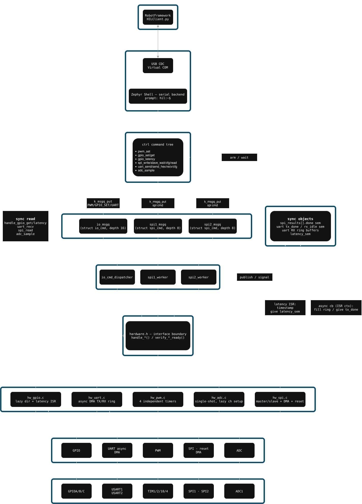
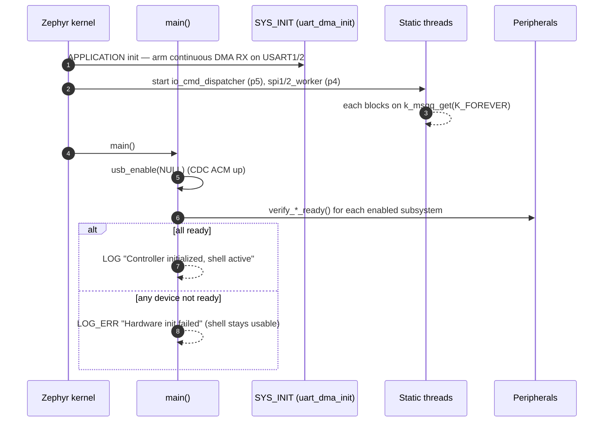
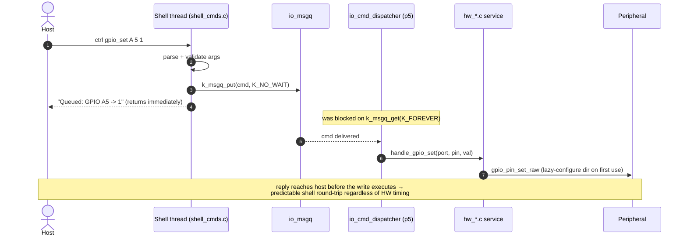
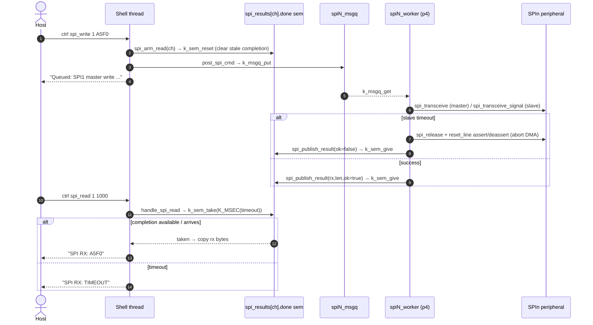
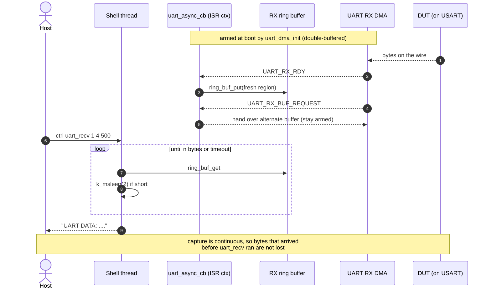

# Testbench Firmware Architecture

> ↩ [Testbench firmware](../README.md) · [Pix-in-the-Loop root](../../README.md)

The testbench firmware is the **HIL Controller** that runs on the STM32F401 Blackpill
(`firmware/`). The host (RobotFramework / `HILClient.py`) drives it over a USB CDC
virtual COM port using the Zephyr shell `ctrl` command tree. Each command is validated
on the shell thread and then either **queued** to a worker thread (asynchronous writes)
or **executed inline** (synchronous reads).

Two views are provided:

- **Static diagram** — the structural decomposition: layers, modules, IPC objects,
  threads, and the hardware they own.
- **Dynamic diagram** — the runtime behaviour: boot, the async write path, the SPI
  round-trip handshake, and the DMA-backed UART receive path.

---

## Static diagram (structure)

---

## Dynamic diagram (behaviour)

### 1. Boot

### 2. Asynchronous write path (PWM / GPIO set / UART send / cfg)

### 3. SPI round-trip — `spi_write` then `spi_read` (cross-thread handshake)

### 4. DMA-backed UART receive (decoupled capture)

> The synchronous reads **gpio_get**, **gpio_latency** (fires a stimulus edge and times
> the response via a GPIO ISR + `latency_sem`), and **adc_sample** follow the same inline
> pattern as `spi_read`/`uart_recv`: they run entirely on the shell thread and reply with
> the measured value, so they are immune to USB/shell round-trip jitter.
